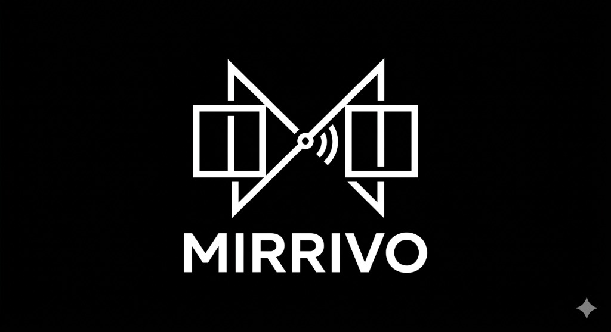

<div align="center">

  

  # MIRRIVO

  **Aesthetic, Single-File Portable Android Screen Mirroring & PC Control**  
  *Ultra-low latency (sub-30ms), dual USB &amp; Wireless Wi-Fi modes, zero-dependency standalone executable.*

  [-black?style=for-the-badge&logo=windows)](https://github.com)
  [](https://dotnet.microsoft.com)
  [](https://github.com/Genymobile/scrcpy)
  [](https://vercel.com/geist)
  [](LICENSE)

  <br />

  [**Download Latest Portable Exe**](https://github.com/anmoldev06/MIRRIVO/releases) • [**Features**](#-features) • [**Quick Start**](#-quick-start) • [**Controls**](#-controls--shortcuts) • [**Architecture**](#-architecture)

</div>

---

## ⚡ Overview

**MIRRIVO** is an ultra-modern, zero-installation desktop application built for developers, power users, and gamers who need seamless Android phone screen mirroring and full PC mouse/keyboard control over both **USB Cable** and **Wireless Wi-Fi (ADB)**.

Designed strictly in accordance with **Vercel's Geist Design System**: deep black monochrome canvas (`#0A0A0A`), crisp 1px hairline borders (`#262626`), high-contrast typography, and radiant multi-stop mesh gradients.

---

## ✨ Features

* **📦 Truly Single Portable Executable (`.exe`)**:
  * Self-contained single binary. No need to install .NET runtimes, Scrcpy, or ADB separately — everything is embedded and ready to run on any clean Windows machine.
* **📶 Dual Connection Modes**:
  * **USB Cable Mode**: Instant plug-and-play auto-detection with real-time battery and hardware telemetry.
  * **One-Click Switch to Wireless Wi-Fi**: Start on cable, click *"Switch to Wi-Fi"*, and unplug the cable. MIRRIVO configures ADB TCP/IP and connects automatically.
  * **Android 11+ Wireless Pairing**: Pair and connect purely over Wi-Fi using the 6-digit pairing code without ever touching a USB cable.
* **⚡ Sub-30ms Low Latency Wi-Fi Mode**:
  * Special bufferbloat mitigation (`--video-buffer 0`, optimal 8 Mbps bitrate, hardware H.264 acceleration) ensures butter-smooth wireless response.
* **📊 Live Stream FPS & On-Screen Refresh Rate**:
  * Real-time stream FPS meter on the dashboard.
  * Live toggle to enable on-device screen refresh rate / FPS overlay directly on your phone's display.
* **📌 Live Real-Time "Always on Top" Toggle**:
  * Pin or unpin the active mirror window on-the-fly without restarting the stream using native Win32 window management.
* **🎯 Show Physical Touches**:
  * Instant Android OS-level white circular touch dot visualization.
* **🌙 Never Sleep / Battery Saver**:
  * **Never Sleep Mode**: Sets Android display timeout to ~68 years (`2,147,483,647 ms`) so the screen never sleeps during work.
  * **Screen-Off Mirroring**: Stream on PC while turning off the physical phone screen to prevent heating and save battery.
* **📥 Drag-and-Drop Installation & Transfer**:
  * Drag any `.apk` onto the MIRRIVO window to auto-install.
  * Drag any file to auto-transfer to `/sdcard/Download/`.
* **🎮 Quick Hardware Remote**:
  * One-click buttons for Back (⮌), Home (○), Recent Apps (□), Power (⏻), Volume Up/Down (+/-), and Screenshot (📷).

---

## 🚀 Quick Start

### 1. Download
Grab the latest single portable executable from the [Releases](https://github.com/anmoldev06/MIRRIVO/releases) page:
* **`Mirrivo.exe`** (Self-Contained Portable, ~86 MB — runs on any Windows 10/11 PC).

### 2. Enable USB Debugging on Your Android Phone
1. Open **Settings > About Phone** and tap **Build Number** 7 times to enable Developer Options.
2. Open **Settings > Developer Options** and enable **USB Debugging**.
3. Plug your phone into your PC via USB cable and tap **"Always allow from this computer"** when prompted.

### 3. Run MIRRIVO
Double-click `Mirrivo.exe`. Your phone will appear on the dashboard. Click **`▶ START MIRRORING`**!

---

## 📶 Wireless Connection Guide

### Option A: One-Click Wireless Switch (Easiest)
1. Connect your phone via USB cable once.
2. In MIRRIVO, click **`📶 Switch to Wi-Fi`**.
3. MIRRIVO will fetch your phone's Wi-Fi IP, configure TCP mode on port 5555, and connect wirelessly.
4. **Unplug the USB cable** — your phone remains connected wirelessly!

### Option B: Direct Wireless Pairing (Android 11+)
1. Ensure both your PC and Phone are on the same Wi-Fi network.
2. On your phone: **Settings > Developer Options > Wireless Debugging (ON)**.
3. Tap **"Pair device with pairing code"**.
4. In MIRRIVO, click **`＋ Wireless Link`** on the top navigation bar, choose **"Pair with Code"**, enter the IP, Port, and 6-digit Code, then click **Pair & Connect**.

---

## 🎮 Controls & Shortcuts

| Action | Mouse / Keyboard Shortcut |
| :--- | :--- |
| **Tap / Touch** | Left Click |
| **Back Button** | Right Click |
| **Home Button** | Middle Mouse Click / Home Key |
| **App Switcher** | Alt + Tab / Switch Button |
| **Scroll / Swipe** | Mouse Wheel / Click & Drag |
| **Text Input** | Type directly on PC Keyboard |
| **Screen Off** | Toggle in MIRRIVO UI / Hardware button |
| **Volume Up / Down** | Hardware Remote `＋` / `－` buttons |
| **Screenshot** | Hardware Remote `📷 Snap` button |

---

## 🛠️ Architecture & Tech Stack

```
MIRRIVO/
├── src/
│   └── Mirrivo/
│       ├── Assets/            # Brand Logo, Icons, Images
│       ├── Converters/        # WPF XAML Data Converters
│       ├── Engine/            # Embedded Scrcpy v5.0.1 + ADB Binaries
│       ├── Models/            # DeviceItem, StreamConfig, LogEntry
│       ├── Services/          # AdbService, MirrorService, EngineService
│       ├── Styles/            # Vercel Geist Theme (Colors, Tokens, Controls)
│       ├── ViewModels/        # MainViewModel (MVVM CommunityToolkit)
│       └── Views/             # MainWindow, WirelessConnectDialog
├── DESIGN-vercel.md           # Vercel Geist Design System Specifications
└── README.md                  # Documentation
```

* **Frontend**: WPF (Windows Presentation Foundation) with custom Vercel Geist styling dictionary.
* **Runtime**: .NET 10.0 (C# 14).
* **Architecture Pattern**: MVVM with `CommunityToolkit.Mvvm`.
* **Streaming Engine**: Scrcpy 5.0 Core Protocol (H.264/H.265 hardware accelerated).
* **Bridge**: Android Debug Bridge (ADB) 1.0.41.
* **Single-File Bundling**: Self-contained single-file publish with native binary extraction.

---

## 💻 Building From Source

### Prerequisites
* [.NET 10.0 SDK](https://dotnet.microsoft.com/download/dotnet/10.0)
* Windows 10 (version 1809+) or Windows 11

### Build Steps
```bash
# Clone the repository
git clone https://github.com/anmoldev06/MIRRIVO.git
cd MIRRIVO

# Build the project
dotnet build src/Mirrivo/Mirrivo.csproj -c Release

# Publish single standalone portable executable
dotnet publish src/Mirrivo/Mirrivo.csproj -c Release -r win-x64 --self-contained true -p:PublishSingleFile=true -p:IncludeNativeLibrariesForSelfExtract=true -o release
```

---

## 📄 License

This project is licensed under the [MIT License](LICENSE).
Embedded Scrcpy is licensed under the Apache License 2.0 by Genymobile.

---

<div align="center">
  <sub>Crafted with precision &amp; care. Powered by Scrcpy 5.0 and .NET 10.</sub>
</div>
